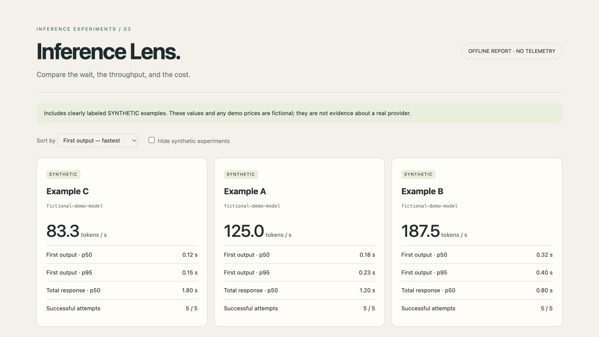

# Inference Lens



An offline dashboard for Stream Meter results: sortable experiment cards, latency bars, p50/p95 statistics, error counts, comparability checks and an adjustable cost sandbox. The output is a self-contained HTML file; no build system, hosting, external JavaScript or telemetry is required.

**Status:** new prototype created October 24, 2026 with AI coding assistance. The demo uses fictional experiment names, synthetic timings and illustrative prices. It makes no claim about a real model or provider.

## Try the demo

```sh
python3 report.py --demo --out demo.html
```

Open `demo.html` in a browser. Try sorting, hiding synthetic runs, and changing input/output token counts.

## Import real measurements

Requires Python 3.11+. Use one or more JSON reports from Stream Meter:

```sh
python3 report.py run-a.json run-b.json --prices prices.json --out comparison.html
```

Prices are optional and keyed by each benchmark's `--label`. Values are **USD per million tokens**. Example (illustrative, not current provider pricing):

```json
{"experiment-a": {"input": 0.20, "output": 0.80}}
```

The generator recomputes statistics from individual runs instead of trusting precomputed summaries. It requires an explicit `synthetic` flag and rejects negative, non-finite or malformed measurements. Missing values remain unavailable. HTML-embedded JSON escapes HTML delimiters, and labels render as text, so imported model names cannot become HTML.

## Reading the report

* TTFT includes first reasoning output; total time includes the entire request.
* Token speed is provider-reported completion tokens divided by elapsed time. It can include reasoning tokens and is not pure decoder throughput.
* Cost estimates use only your supplied prices. They omit caching discounts, taxes, additional charges and unknown reasoning-token behavior.
* Mean measured cost includes only successful requests with both input/output usage. The report shows the number of priced requests. It is not a complete billing ledger: failed requests can also incur costs.
* The cost sandbox uses your chosen token counts and request count. It does not make API requests.
* Comparison notes flag different prompts, concurrency, token limits, small samples and missing data. Equal configuration does not guarantee equal caching or backend load.
* Generated reports include model IDs and experiment labels. Review them before sharing.

## Validation

```sh
python3 -m unittest discover -s tests -v
```
